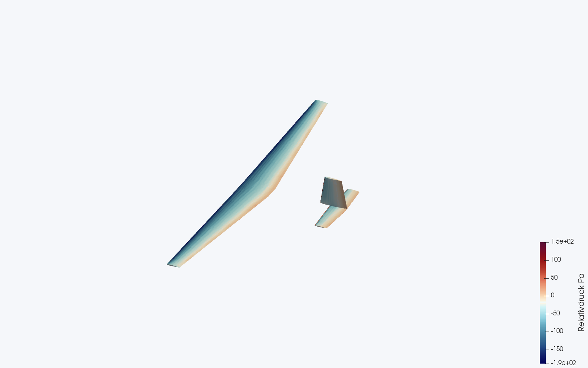
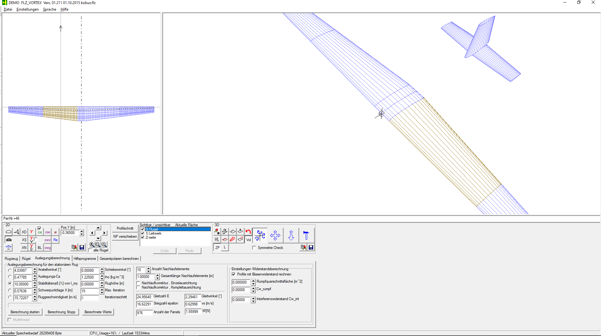
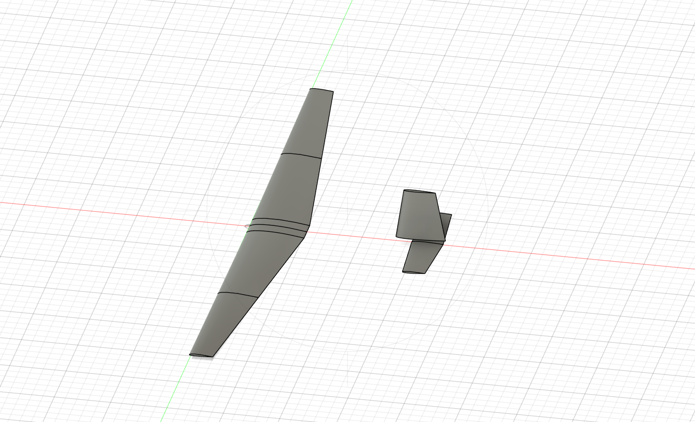
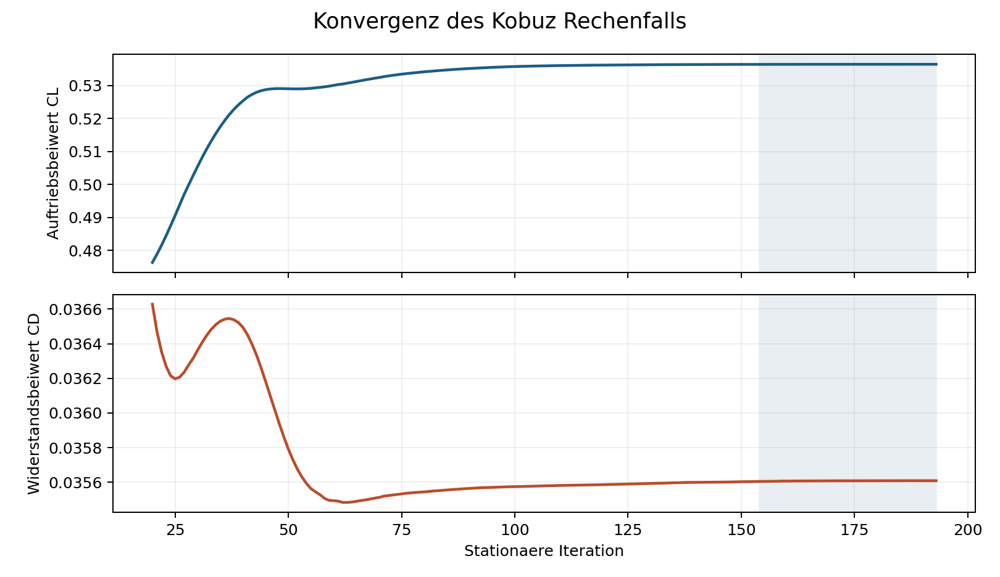
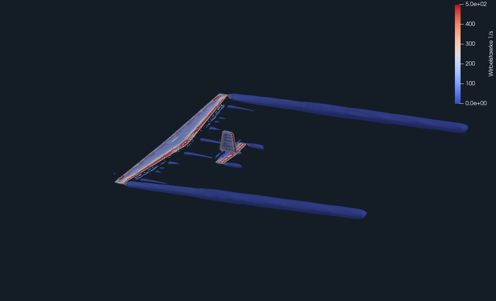

# Den Kobuz mit Fusion und OpenFOAM untersuchen

## Von der FLZ Datei zur Druckverteilung und zu den Randwirbeln

Ich wollte die in FLZ_VORTEX beschriebene Kobuz-Geometrie als dreidimensionales Modell aufbauen und anschließend die Umströmung berechnen. Dieser Beitrag dokumentiert meinen Weg über Fusion 360, einen geprüften STL-Export und OpenFOAM unter Windows. Die Ergebnisse werden in ParaView dargestellt. Die CAD-Erstellung und die Einrichtung der Rechnung erfolgten mit Unterstützung von Codex und einer verbundenen Fusion-Schnittstelle. Die Anleitung erklärt die Geometrie und die Recheneinstellungen auch unabhängig davon.

Die erste stationäre Rechnung liefert für Flügel und Leitwerke ein Verhältnis von Auftrieb zu Widerstand von ungefähr 15,1. Das ist ein Ergebnis dieses vereinfachten Rechenfalls. Für eine belastbare Gleitzahl des kompletten Flugzeugs fehlen unter anderem der Rumpf, eine Trimmung und eine Untersuchung der Netzabhängigkeit. Die Bilder zeigen tatsächlich berechnete Felder, keine nachträglich gezeichneten Strömungslinien.



Abbildung 1: Relativdruck auf Flügel und Leitwerken bei 15,72 m/s und 4,04 Grad Anstellwinkel. Der OpenFOAM-Druck wurde mit der Luftdichte multipliziert und wird hier in Pascal angezeigt. Ansicht des Endstands nach 193 stationären Iterationen.

## 1 Ausgangsdaten und verwendete Programme

Die Quelle war die Datei `kobuz.flz`. Ein Screenshot allein hätte nicht genügt: Die Datei enthält neben Spannweiten, Profiltiefen und Winkeln auch die ursprünglichen Profilkoordinaten. Diese Koordinaten wurden übernommen. Ein ähnlich benanntes Standardprofil hätte die modifizierten Profile nicht zuverlässig ersetzt.

| Bestandteil | Verwendete Umgebung |
| --- | --- |
| Betriebssystem | Windows mit WSL 2 und Ubuntu 24.04 LTS |
| Strömungsrechnung | OpenFOAM Foundation Version 14 |
| Darstellung | ParaView 5.11.2 |
| CAD | Autodesk Fusion 360 mit parametrischer Modellhistorie |
| Geometriequelle | kobuz.flz aus FLZ_VORTEX 01.211 |
| Parallelrechnung | Vier Prozesse auf der CPU |

Die Anleitung bezieht sich ausdrücklich auf die Foundation-Ausgabe von OpenFOAM. Konfigurationen für OpenCFD-Ausgaben mit Jahresnummern oder ältere Anleitungen mit `simpleFoam` lassen sich nicht unverändert übernehmen. Hier wird `foamRun` mit dem Solver-Modul `incompressibleFluid` verwendet.

Der Rechner hatte acht logische CPU-Kerne; WSL standen ungefähr 7,7 GiB Arbeitsspeicher und 2 GiB Swap zur Verfügung. Die eigentliche Solverrechnung benötigte zuletzt etwa 8,5 Minuten. Die Netzerzeugung kommt hinzu und kann deutlich länger dauern. Das sind Messwerte dieses Rechners, keine zugesicherte Laufzeit.

Dem Beitrag liegt `Kobuz_Beispiel.zip` bei. Darin befinden sich die ursprüngliche vollständige Fusion-Datei, die bereinigte Geometrie, sämtliche OpenFOAM-Eingabedateien, Startskripte und die protokollierten Ergebnisse. Das große berechnete Volumennetz und die vollständigen Strömungsfelder sind nicht enthalten; sie werden beim Nachrechnen erzeugt. Die separate Datei `RC_Network_Publikationspaket.zip` enthält diese Anleitung und die Abbildungen gemeinsam mit dem Beispiel.

## 2 OpenFOAM unter Windows installieren

### Windows und Ubuntu vorbereiten

WSL führt Linux-Programme innerhalb von Windows aus. Die Linux-Dateien sind über den Windows-Explorer erreichbar. Für die folgenden Installationsschritte wird einmal eine PowerShell mit Administratorrechten geöffnet. Wenn WSL bereits vorhanden ist, zuerst die vorhandenen Distributionen prüfen.

```powershell
wsl --list --verbose
wsl --install -d Ubuntu-24.04
wsl --update
```

Falls Windows einen Neustart verlangt, diesen durchführen. Ubuntu 24.04 anschließend über das Startmenü öffnen und den Linux-Benutzernamen sowie ein Kennwort anlegen. Das Kennwort erscheint bei der Eingabe nicht auf dem Bildschirm. `wsl --list --verbose` sollte für diese Distribution Version 2 anzeigen. Falls nötig:

```powershell
wsl --set-version Ubuntu-24.04 2
wsl -d Ubuntu-24.04
```

Die folgenden Befehle gehören in das Ubuntu-Terminal, nicht in PowerShell. Bei meinem ersten Versuch lief OpenFOAM unter Ubuntu 26.04 auf dem älteren Intel-i7-Rechner wegen eines Fehlers vom Typ `Illegal instruction` nicht. Die separate Ubuntu-24.04-Installation funktionierte. Pakete einer anderen Ubuntu-Version in die bestehende Distribution zu mischen, erwies sich hier ebenfalls als ungeeignet. Deshalb dokumentiere ich die funktionierende Kombination.

### OpenFOAM und ParaView installieren

Für eine frische Ubuntu-24.04-Installation kann das Paketarchiv wie folgt eingebunden werden. Der Schlüssel wird über HTTPS geladen. Die Paketdateien werden anhand dieses Schlüssels geprüft. Die Foundation beschreibt Installation und Benutzerkonfiguration in ihrer offiziellen Anleitung [1]. Vorhandene abweichende OpenFOAM-Paketquellen sollten nicht zusätzlich vermischt werden.

```bash
sudo apt update
sudo apt install -y wget software-properties-common
sudo add-apt-repository -y universe
wget -qO /tmp/openfoam.asc https://dl.openfoam.org/gpg.key
sudo cp /tmp/openfoam.asc /etc/apt/trusted.gpg.d/openfoam.asc
echo 'deb [arch=amd64] http://dl.openfoam.org/ubuntu noble main' | \
  sudo tee /etc/apt/sources.list.d/openfoam.list
sudo apt update
sudo apt install -y openfoam14 paraview
```

Die OpenFOAM-Umgebung muss in jedem neuen Terminal geladen sein. Für das aktuelle Terminal:

```bash
source /opt/openfoam14/etc/bashrc
foamRun -help
```

Eine Hilfeausgabe bestätigt, dass das Programm aufgerufen werden kann. Damit die Umgebung automatisch geladen wird, einmal in `~/.bashrc` die folgende Zeile ergänzen. Dort darf nicht gleichzeitig eine andere OpenFOAM-Version aktiviert werden.

```bash
source /opt/openfoam14/etc/bashrc
```

### Installation mit einem kleinen Beispiel prüfen

Vor dem Flugzeugfall lohnt sich ein mitgeliefertes Beispiel. In einem neuen Arbeitsverzeichnis ausführen:

```bash
mkdir -p ~/OpenFOAM/tests
cd ~/OpenFOAM/tests
cp -r "$FOAM_TUTORIALS/incompressibleFluid/pitzDailySteady" .
cd pitzDailySteady
blockMesh
checkMesh
foamRun
```

Bei meinem Test konvergierte dieses Beispiel nach 285 Iterationen. Die genaue Zahl kann je nach Paketstand abweichen. Unter Windows mit WSLg lässt sich anschließend auch die Linux-Version von ParaView öffnen. Falls kein Fenster erscheint, zunächst WSL aktualisieren und die grafische Umgebung prüfen. Die Foundation erläutert den Betrieb unter Windows separat [2].

## 3 Den Kobuz in Fusion 360 aufbauen

### Geometrie aus FLZ übernehmen

Für den Nachbau werden die Werte aus den Abschnitten `FLAECHE0`, `FLAECHE1` und `FLAECHE2` verwendet. Die Einträge `PK0`, `PK1` und so weiter beschreiben die Profilpunkte. Die FLZ-Längen sind in Metern abgelegt; für das CAD-Modell wurden sie in Millimeter umgerechnet.

Das verwendete Koordinatensystem lautet: X von der Nasenleiste zur Endleiste und weiter zum Leitwerk, Y entlang der Spannweite, Z nach oben. Der Ursprung liegt an der Nasenleiste in der Flügelmitte. Das vermeidet spätere Verwechslungen zwischen CAD-Achsen und Strömungsrichtung.

| Flügelstation auf einer Seite | Abstand Y in mm | Höhe Z in mm | Tiefe in mm | Profil aus FLZ |
| --- | --- | --- | --- | --- |
| Mitte | 0 | 0 | 255 | MH-30mod_PK |
| Ende des Mittelstücks | 60 | 0 | 255 | MH-30mod_PK |
| Zwischenstation | 669,907 | 10,646 | 180 | MHSD-3003mod_PK |
| Spitze | 1279,814 | 21,292 | 105 | SD7003mod_PK |

Die andere Seite verwendet dieselben Höhen mit negativem Y. Je Halbflügel gibt es drei Segmente: 60 mm mit null Grad V-Form und zweimal 610 mm mit einem Grad V-Form. Die Segmentbreite ist die Länge entlang des geneigten Segments; ihr Anteil in Y ist Breite mal Kosinus des Winkels, ihr Anteil in Z Breite mal Sinus. Daher beträgt die projizierte Spannweite rund 2559,63 mm und nicht exakt 2560 mm. Pfeilung und Verwindung des Hauptflügels sind in diesem Modell null.

### Profilschnitte und solide Flügelsegmente erzeugen

In Fusion ein neues parametrisches Design anlegen und die Modellhistorie aktivieren. Für Tiefe, Segmentbreite und V-Form Benutzerparameter erstellen. Die geschlossenen Profilschnitte liegen in Ebenen parallel zur XZ-Ebene. Normierte Profilkoordinaten werden mit der jeweiligen Profiltiefe skaliert und an die Station verschoben.

Im tatsächlich verwendeten Skript wurde der Hauptflügel aus fixierten interpolierenden Splines durch die Originalpunkte aufgebaut. Eine Linie schließt die endliche Endleiste. Die Profilform selbst ist damit festgelegt; Profiltiefe und Lage bleiben über Skalierungs- und Verschiebefeatures veränderbar. Zwischen jeweils zwei benachbarten Schnitten entsteht ein gerader Loft als neuer Volumenkörper. Die Flügelspitzen werden eben geschlossen. Autodesk beschreibt den grundlegenden Solid-Loft-Arbeitsablauf unter [3].

Für einen manuellen Nachbau bedeutet das: Originalpunkte in die jeweilige Skizze übernehmen, die Kontur schließen, die Stationen positionieren und jeweils zwei Profile mit einem Solid-Loft verbinden. Die genaue Spline-Interpolation und die Loft-Zuordnung müssen dabei kontrolliert werden. Allein dieselben Tabellenmaße garantieren noch keine identische Profiloberfläche. Für eine identische Ausgangsgeometrie ist deshalb die beigelegte `.f3d`-Datei zweckmäßiger.

Zunächst entstanden sechs solide Flügelsegmente und 19 Benutzerparameter. Beim ersten Aufbau hatte Fusion den Skalierungsfaktor als festen Zahlenwert gespeichert. Erst die ausdrückliche Verknüpfung mit dem Parameter, beispielsweise `Tiefe_R3 / 100 mm`, stellte die beabsichtigte Aktualisierung sicher. Anschließend wurden Tiefe, Segmentbreite und V-Form testweise geändert, an der tatsächlichen Körpergeometrie geprüft und auf die ursprünglichen FLZ-Werte zurückgesetzt. Die Modellhistorie meldete danach keine Fehler.

### Die Segmente zu einem Flügel vereinigen

Die sechs aneinanderliegenden Segmente müssen vor dem STL-Export zu einem Flügelkörper vereinigt werden. Dazu in Fusion `Ändern > Kombinieren` beziehungsweise `Modify > Combine` wählen, einen Zielkörper und die übrigen Segmente als Werkzeugkörper auswählen und die Operation `Vereinigung` beziehungsweise `Join` verwenden. Die Werkzeugkörper sollen nicht zusätzlich als überlagerte Kopien erhalten bleiben.

Im Browser danach genau einen sichtbaren soliden Flügelkörper prüfen. Die Grenzen zwischen den ursprünglichen Loft-Flächen können weiterhin als Linien sichtbar sein; sie bedeuten nicht automatisch, dass noch sechs Körper vorhanden sind. Eine lokale `.f3d`-Datei sichert zusätzlich die Modellhistorie.

### Höhenleitwerk und Seitenleitwerk ergänzen

| Größe | Höhenleitwerk | Seitenleitwerk |
| --- | --- | --- |
| Position X Y Z in mm | 720  0  0 | 650  0  20 |
| Wurzeltiefe in mm | 140 | 220 |
| Spitzentiefe in mm | 100 | 140 |
| Ausdehnung in mm | Spannweite 570 | Höhe 230 |
| Nasenleistenpfeilung | 3,61388 Grad | 8,65254 Grad |
| Einstellwinkel | minus 1 Grad | 0 Grad |
| Profil | HD800 | NACA0012 |

Das Höhenleitwerk besteht aus zwei Halbseiten mit jeweils 285 mm Breite. Diese werden untereinander vereinigt. Das Seitenleitwerk wird zunächst als Profil-Loft aufgebaut, um die X-Achse um 90 Grad aufgestellt und danach positioniert. Beim Höhenleitwerk wird der Einstellwinkel um die Y-Achse angebracht. Die Pfeilung verschiebt die Nasenleiste der Außenstation in X um die Segmentbreite mal Tangens des Pfeilwinkels.

Das vollständige Fusion-Modell enthält drei solide Körper und 41 Benutzerparameter. Es bildet nur die aerodynamischen Außenflächen ab. Rumpf, Holm, Rippen, Servos und sonstiger Innenaufbau sind nicht modelliert. Später erstellte Formen und veränderte Leitwerksränder gehören nicht zu diesem CFD-Fall.



Abbildung 2: Das Kobuz-Ausgangsmodell in FLZ_VORTEX mit Hauptflügel und Leitwerken. Die Datei kobuz.flz lieferte die Maße und Profilkoordinaten für den Aufbau in Fusion. Der Screenshot zeigt die ursprüngliche Modellansicht und die damals angezeigten Auslegungswerte.



Abbildung 3: Das ursprüngliche Fusion-Modell mit Flügel, Höhenleitwerk und Seitenleitwerk. Die dargestellten Grenzen der Loft-Flächen sind Teil der CAD-Oberfläche.

## 4 STL exportieren und die Geometrie prüfen

### Export in Fusion

Die drei endgültigen Volumenkörper auswählen und mit `Als Netz speichern` beziehungsweise `Save As Mesh` als STL exportieren. Hilfsprofile, unsichtbare Zwischenkörper und Kopien nicht mit exportieren. Eine ausreichend feine Auflösung verwenden, besonders an Nasenleiste und Endleiste. Die verwendete vollständige Exportdatei hatte 22 668 Dreiecke. Die exakten damaligen Dialogwerte der Netzverfeinerung sind nicht protokolliert; eine bestimmte Fusion-Voreinstellung wird deshalb hier nicht als historischer Wert ausgegeben. Die Exportmöglichkeiten und die Auswahl der Einheit beschreibt Autodesk unter [4].

STL speichert keine verbindliche Maßeinheit. Selbst nach einer Änderung im Exportdialog hatte meine Datei noch eine Spannweite von etwa 2559,63 in ihren Zahlenwerten. Das waren Millimeter. Für OpenFOAM muss die Spannweite dagegen etwa 2,55963 betragen. Entscheidend ist die gemessene Ausdehnung, nicht die Dateibezeichnung.

Eine Datei darf mehrere getrennte geschlossene Körper enthalten. Für die äußere Umströmung ist zwischen Flügel und Leitwerken Luft, also ein zusammenhängendes Strömungsgebiet. Fehlerhaft wären offene Oberflächen, doppelte innere Trennflächen oder tatsächliche Überschneidungen. Der Prüfer muss die drei Körper jeweils als geschlossene Hülle erkennen.

### Oberfläche vor der Vernetzung kontrollieren

Die STL-Datei in einem eigenen Arbeitsverzeichnis prüfen, weil `surfaceCheck` bei Bedarf zusätzliche Diagnosedateien schreibt:

```bash
source /opt/openfoam14/etc/bashrc
surfaceCheck -checkSelfIntersection kobuz.stl
```

Beim ersten Flügelexport waren die Segmente noch nicht vereinigt. Dadurch entstanden doppelte Dreiecke und Kanten mit mehr als zwei angrenzenden Flächen. Das wurde in Fusion durch die Vereinigung korrigiert. Der anschließend exportierte einteilige Flügel war geschlossen; eine sehr kleine Schnittmeldung blieb übrig.

Beim vollständigen Modell wurden die Koordinaten mit dem Faktor 0,001 in Meter umgerechnet und als ASCII-STL mit hoher Zahlenpräzision geschrieben. Die verbleibenden Schnittmeldungen lagen an gemeinsamen Kanten oder Punkten innerhalb der numerischen Exportpräzision. Eine gezielte minimale Verschiebung von elf betroffenen Vertices beseitigte diese Meldungen. Die größte Verschiebung betrug 8,15 Nanometer; die Dreieckszahl blieb unverändert. Das war eine numerische Bereinigung dieses konkreten Exports. Größere CAD-Überlappungen oder Löcher würde diese Maßnahme nicht sachgerecht reparieren.

Im beigelegten Fall ist diese bereits geprüfte Datei als `constant/geometry/kobuz.stl` enthalten. Sie muss nicht nochmals skaliert oder bereinigt werden. Der abschließende Bericht meldet eine geschlossene Oberfläche, drei getrennte Teile und keine Selbstüberschneidung. Die Ausdehnungen betragen ungefähr 0,870 m in X, 2,560 m in Y und 0,258 m in Z.

## 5 Den OpenFOAM Fall vorbereiten

### Ordner und Eingabedateien

Das Beispielarchiv unter Windows entpacken, beispielsweise nach `C:\CFD`. Im Archiv liegt der eigentliche Fall im Unterordner `Kobuz`. WSL sieht den Pfad als `/mnt/c/CFD/Kobuz`. Für größere Rechnungen kann der Fall in das Linux-Dateisystem kopiert werden; das vermeidet häufig langsame Zugriffe auf viele kleine Dateien.

```bash
mkdir -p ~/OpenFOAM
cp -r /mnt/c/CFD/Kobuz ~/OpenFOAM/Kobuz
cd ~/OpenFOAM/Kobuz
```

Die Befehle setzen ein neues Zielverzeichnis voraus. Für einen weiteren Versuch eine eigene Kopie anlegen, damit vorherige Ergebnisse erhalten bleiben. Der ursprüngliche Rechenlauf verwendete einen Ordner auf dem Windows-Laufwerk.

| Ordner oder Datei | Inhalt |
| --- | --- |
| 0 | Anfangs- und Randwerte für U p k omega und nut |
| constant/geometry | Bereinigte STL-Geometrie |
| constant/physicalProperties | Kinematische Viskosität |
| constant/momentumTransport | Turbulenzmodell |
| system | Netzparameter Solversteuerung und Kräfteauswertung |
| run.sh | Netz erzeugen prüfen rechnen und Ergebnisse zusammenführen |
| Kobuz.foam | Leere Erkennungsdatei für ParaView |

### Strömung und Randbedingungen

| Einstellung | Wert |
| --- | --- |
| Geschwindigkeit | 15,72207 m/s |
| Anstellwinkel | 4,03997 Grad |
| Schiebewinkel | 0 Grad |
| Luftdichte für die Kräfte | 1,225 kg/m³ |
| Kinematische Viskosität | 0,000015 m²/s |
| Turbulenzmodell | Stationäres RAS mit kOmegaSST |
| Turbulenzintensität am Eintritt | 0,5 Prozent |
| Turbulenzlängenskala am Eintritt | 0,02 m |
| Bezugsfläche | 0,4698 m² für den Hauptflügel |
| Bezugslänge | 0,194623 m |
| Momentenbezugspunkt | X 0,07636 m  Y 0  Z 0 |

Der Flügel bleibt in seiner CAD-Lage. Der Anstellwinkel wird durch die Anströmrichtung vorgegeben: U = (15,68300293; 0; 1,10765702) m/s. Die positiven Z-Komponenten der Anströmung sind deshalb beabsichtigt. Das Höhenleitwerk besitzt zusätzlich seinen geometrischen Einstellwinkel von minus einem Grad.

Am Eintritt wird U fest vorgegeben; am Austritt verwendet U eine `inletOutlet`-Bedingung. Die übrigen äußeren Grenzen sind Fernfeldgrenzen. Die Körperoberflächen haben `noSlip`. Für p gilt am Austritt der Referenzwert null, an den Körpern `zeroGradient` und am Fernfeld `freestreamPressure`. Bei Foundation 14 enthält diese Fernfeldbedingung hier sowohl `freestreamValue uniform 0` als auch `value uniform 0`. Ein fehlender erster Eintrag hatte zunächst einen Abbruch verursacht und wurde ergänzt.

Die Turbulenzgrößen k und omega werden aus Intensität und Längenskala bestimmt. An den Wänden werden `kqRWallFunction`, `omegaWallFunction` und für nut `nutkWallFunction` verwendet. Der Fall ist vollständig turbulent angesetzt; ein laminar-turbulenter Umschlag wird nicht eigens modelliert. Bei der mittleren Flügeltiefe beträgt die Reynolds-Zahl etwa 204 000. Für Modellflugprofile kann die Umschlagslage den Widerstand stark beeinflussen.

## 6 Das Strömungsnetz erzeugen

Das STL-Netz beschreibt nur die Oberfläche. OpenFOAM benötigt zusätzlich ein Volumennetz in der umgebenden Luft. `blockMesh` erzeugt dafür einen rechteckigen Hintergrundblock. `snappyHexMesh` verfeinert ihn, passt ihn an die STL-Oberfläche an und versucht, zusätzliche wandnahe Schichten aufzubauen.

| Netzparameter | Einstellung |
| --- | --- |
| Außenbereich X | minus 2 bis plus 6 m |
| Außenbereich Y | minus 4 bis plus 4 m |
| Außenbereich Z | minus 3 bis plus 3 m |
| Hintergrundnetz | 50 mal 50 mal 38 Zellen |
| Oberflächenverfeinerung | Stufen 4 bis 5 |
| Scharfe Kanten | Stufe 5 |
| Körpernahe Box | Stufe 3 |
| Nachlaufbox | Stufe 2 |
| Gewünschte Wandschichten | 5 mit Wachstumsfaktor 1,2 |

Die körpernahe Box reicht von (-0,15; -1,5; -0,16) bis (1,05; 1,5; 0,42) m. Die Nachlaufbox reicht von (0; -1,5; -0,15) bis (3; 1,5; 0,45) m. Der im `snappyHexMeshDict` angegebene `insidePoint` liegt in der Luft. Damit wird der äußere Fluidbereich behalten; es soll nicht innerhalb des soliden Flügels gerechnet werden.

Für einen einzeln beobachtbaren Ablauf lauten die Schritte:

```bash
blockMesh > log.blockMesh 2>&1
surfaceFeatures > log.surfaceFeatures 2>&1
snappyHexMesh -overwrite > log.snappyHexMesh 2>&1
checkMesh -allTopology -meshQuality > log.checkMesh 2>&1
tail -n 30 log.checkMesh
```

Die erste Netzausführung zeigte in einer erweiterten Prüfung problematische Flächen. Danach wurden unter anderem `minFaceWeight` auf 0,05 und `maxBoundarySkewness` auf 4 gesetzt und das Netz neu erzeugt. Das endgültige Netz hat 884 609 Zellen. Die größte Nichtorthogonalität beträgt 62,32 Grad, die größte Skewness 3,957. Alle Zellvolumina sind positiv. Die verwendete Topologie- und Qualitätsprüfung endet mit `Mesh OK`.

Diese Aussage bezieht sich auf genau diese Prüfung und ihre Grenzwerte. Erweiterte Geometriediagnosen hatten auch konkave Zellen ausgewiesen; sie sind durch ein `Mesh OK` nicht als eigenständige Untersuchung erledigt. Ebenso ist ein bestandener Qualitätscheck noch kein Nachweis der Netzunabhängigkeit.

Etwa 98,5 Prozent der vorgesehenen Oberflächen erhielten Schichten; im Mittel entstanden rund 4,24 der gewünschten fünf Schichten. Die Schichtdicke war relativ zur lokalen Zelle definiert. Damit wurde kein durchgehend niedriger yPlus-Wert vorgegeben. Diese Einschränkung ist bei der Beurteilung des Widerstands wesentlich.

## 7 Rechnen und den Fortschritt beobachten

Der komplette Ablauf lässt sich in einem frischen Fall mit einem Befehl starten:

```bash
cd ~/OpenFOAM/Kobuz
bash run.sh
```

Das Skript erzeugt zunächst das Netz. Es startet den Solver erst, wenn der Netzbericht `Mesh OK` enthält. Danach zerlegt `decomposePar` den Fall für vier Prozesse; die Rechnung läuft mit `mpirun -np 4 foamRun -parallel`. Anschließend führt `reconstructPar -latestTime` den letzten Stand für ParaView zusammen. Die Zahl der MPI-Prozesse muss mit `numberOfSubdomains` in `system/decomposeParDict` übereinstimmen.

Währenddessen in einem zweiten Ubuntu-Terminal denselben Fallordner öffnen. `stage.txt` zeigt den aktuellen Arbeitsschritt. Sobald die entsprechende Logdatei vorhanden ist, kann sie laufend beobachtet werden:

```bash
cd ~/OpenFOAM/Kobuz
cat stage.txt
tail -f log.snappyHexMesh
```

Beim Solver auf `tail -f log.foamRun` wechseln. Strg+C beendet hier nur die Logansicht. Das laufende Rechenprogramm im ersten Terminal wird dadurch nicht gestoppt. Optional ist die im Beispiel enthaltene lokale Fortschrittsseite nutzbar: In einem weiteren Terminal `python3 progress_server.py` starten und im Windows-Browser `http://127.0.0.1:8766` öffnen. Sie zeigt Stufe, Iteration und zuletzt ausgegebene Kraftbeiwerte. Falls der Port bereits benutzt wird, die vorhandene eigene Fortschrittsseite beenden oder eine andere Portnummer einstellen.

Der Solver ist stationär. Ein Eintrag wie `Time = 193s` bezeichnet hier den Rechenschritt mit der vorgegebenen Schrittweite, keine simulierten 193 Sekunden Flugzeit. Die Obergrenze lag bei 400 Iterationen; die Residuensteuerung beendete die Rechnung bereits nach 193.

Die SIMPLE-Steuerung verlangt p kleiner als 10 hoch minus 6, U kleiner als 10 hoch minus 5 und k sowie omega kleiner als 10 hoch minus 6. Zusätzlich müssen die Kraftbeiwerte betrachtet werden. Bei diesem Lauf lag die gesamte Spannweite der letzten 40 Werte relativ zum Endwert bei ungefähr 0,005 Prozent für CL und 0,013 Prozent für CD. Das zeigt die numerische Stabilisierung dieses Falls.



Abbildung 4: Auftriebs- und Widerstandsbeiwert ab Iteration 20. Der hinterlegte Bereich markiert die letzten 40 Iterationen. Kleine Änderungen belegen die Konvergenz auf diesem Netz, nicht die Richtigkeit des gewählten physikalischen Modells.

## 8 Druck und Wirbel in ParaView darstellen

### Druckverteilung auf den Körpern

Nach der Rekonstruktion im Fallordner ausführen:

```bash
paraview --data="$PWD/Kobuz.foam"
```

Im OpenFOAM-Reader unter `Mesh Regions` die Körperoberfläche auswählen, hier `patch/kobuz`. Für diese Ansicht das `internalMesh` abwählen. p als Feld aktivieren, `Apply` drücken, zum letzten gespeicherten Stand wechseln und die Darstellung auf `Surface` stellen. Mit `Reset Camera` die Geometrie in die Ansicht einpassen.

p ist bei diesem inkompressiblen Solver der kinematische Druck in m²/s². Wer die Originalansicht unmittelbar nach dem Laden nachbildet, sieht deshalb noch keine Pascal-Skala. Für Abbildung 1 wurde ein `Calculator` mit der Formel `1.225*p` auf den Zelldaten verwendet. Das Ergebnis heißt `Relativdruck_Pa`. Nach dieser Größe einfärben und die Skala hier auf minus 190 bis plus 150 Pa einstellen. Es handelt sich um Druck relativ zur Referenz, nicht um den absoluten Luftdruck.

### Randwirbel mit dem Q Kriterium sichtbar machen

Für Wirbel wird das Geschwindigkeitsfeld in der Luft benötigt. Eine reine Ansicht der Körperoberfläche genügt nicht. Einen zweiten OpenFOAM-Reader anlegen, dort `internalMesh` und U auswählen, anwenden und wieder zum letzten Stand gehen. Der folgende Filterweg entspricht der erzeugten Darstellung; die ParaView-Dokumentation erläutert die Ableitung solcher Größen aus Geschwindigkeitsfeldern [5].

1. Auf den Volumen-Reader den Filter `Gradient` anwenden und U als Vektorfeld wählen.
2. `Compute Vorticity` und `Compute Q Criterion` aktivieren. Die vollständige Gradientenausgabe ist dafür nicht erforderlich.
3. `Cell Data to Point Data` anwenden, damit das Q-Feld für die folgende Kontur auf Punkten liegt.
4. Mit `Contour` die Größe `QCriterion` wählen und den Isowert 50 setzen. Die Einheit ist 1/s².
5. Die Kontur nach dem Betrag der `Vorticity` einfärben. Für das Bild wurde die Skala 0 bis 500 1/s und die Deckkraft 0,65 verwendet.
6. Zusätzlich die Körperoberfläche über einen separaten Reader grau anzeigen; das eigentliche Fluidvolumen ausblenden.

Q beschreibt das örtliche Verhältnis von Rotation und Deformation. Positive Werte heben Bereiche hervor, in denen die Rotation überwiegt. Die sichtbare Hülle ist daher eine Isosurface eines berechneten Feldes. Sie ist keine feste physische Außenkante des Wirbels. Der gewählte Schwellwert verändert Größe und Sichtbarkeit der Hülle; für die dokumentierte Ansicht wurde Q = 50 1/s² gewählt.



Abbildung 5: Q-Isosurface bei 50 1/s², eingefärbt nach Wirbelstärke. Die beiden langen Strukturen hinter den Flügelspitzen zeigen die Randwirbel des berechneten Nachlaufs. Kleine körpernahe Strukturen werden von Netz und Auswerteschwelle beeinflusst und sollten nicht ohne weitere Prüfung als einzelne reale Wirbel interpretiert werden.

Im Beispiel liegt `Create_Vortex_View.py`. Nach der Rechnung erzeugt es die Ansicht sowie einen ParaView-Zustand und eine PNG-Datei im Fallordner:

```bash
QT_QPA_PLATFORM=offscreen pvpython Create_Vortex_View.py
paraview --state=Kobuz_Vortices.pvsm
```

Eine stationäre RAS-Rechnung zeigt die berechnete mittlere Strömung. Für zeitliche Wirbelablösung und deren Animation wäre ein anderer, instationärer Rechenansatz nötig. Auch ein ansprechendes Wirbelbild ersetzt keine Prüfung von Auftrieb und Widerstand.

## 9 Kräfte und abgeleitete Gleitwerte auswerten

Die Funktion `forceCoeffs` integriert Druck- und Reibungskräfte auf der Patchgruppe `aircraft`. Darin liegen Flügel und beide Leitwerke. Die Normierung verwendet ausschließlich die Hauptflügelfläche von 0,4698 m². Auftrieb und Widerstand werden senkrecht beziehungsweise parallel zur Anströmung ausgewertet, nicht einfach entlang der festen Z- und X-Achsen. Das Nickmoment bezieht sich auf (0,07636; 0; 0) m um die Y-Achse.

Die Rohdaten schreibt OpenFOAM in `postProcessing/coefficients`. Im Paket stehen außerdem `Force_History.csv` und `Results.json` des dokumentierten Laufs. Bei geänderten Eingaben sind diese Referenzdateien selbstverständlich nicht das neue Ergebnis. Mit `python3 Auswertung.py` liest das beigelegte Skript stattdessen die aktuelle OpenFOAM-Koeffizientendatei und erzeugt neue Dateien mit dem Präfix `Aktuell`.

Für die Umrechnung werden verwendet: Staudruck q = halbe Luftdichte mal Geschwindigkeit zum Quadrat; Auftrieb L = q mal Bezugsfläche mal CL; Widerstand D = q mal Bezugsfläche mal CD; Nickmoment M = q mal Bezugsfläche mal Bezugslänge mal Cm. Das Verhältnis E = L geteilt durch D entspricht bei identischer Normierung CL geteilt durch CD. Für einen passend getrimmten stationären Gleitflug wäre der Gleitwinkel der Arkustangens von 1 geteilt durch E und die Sinkgeschwindigkeit V mal Sinus dieses Winkels.

| Größe im Endstand | OpenFOAM Ergebnis |
| --- | --- |
| CL | 0,53648 |
| CD | 0,035609 |
| Cm um den angegebenen Punkt | minus 0,012246 |
| Auftrieb | 38,159 N |
| Widerstand | 2,533 N |
| Nickmoment | minus 0,170 Nm |
| Auftrieb zu Widerstand | 15,066 |
| Daraus abgeleiteter äquivalenter Gleitwinkel | 3,797 Grad |
| Daraus abgeleitetes äquivalentes Sinken | 1,041 m/s |

Die letzten beiden Werte heißen hier bewusst äquivalent: Die FLZ-Datei ergibt aus Zusatzmasse und den Flächenmassen insgesamt 3,97 kg. Bei g = 9,81 m/s² entspricht das einer Gewichtskraft von 38,946 N. Der berechnete Auftrieb liegt ungefähr zwei Prozent darunter. Außerdem ist das Nickmoment nicht null. Für einen stationären Gleitflug müsste der Auftrieb zur Gewichtskomponente senkrecht zur Flugbahn passen und das Flugzeug um den tatsächlichen Schwerpunkt getrimmt sein. Diese Voraussetzungen wurden mit dem einzelnen Betriebspunkt noch nicht erfüllt.

### Vergleich mit FLZ VORTEX

| Größe | Angezeigter FLZ Stand | Dieser CFD Betriebspunkt |
| --- | --- | --- |
| Anstellwinkel | 4,03997 Grad | 4,03997 Grad |
| Geschwindigkeit | 15,72207 m/s | 15,72207 m/s |
| Gleitzahl beziehungsweise L zu D | 24,9564 | 15,0661 |
| Gleitwinkel | 2,29461 Grad | äquivalent 3,79739 Grad |
| Sinken | 0,62998 m/s | äquivalent 1,04125 m/s |
| Widerstand | 1,55999 N | 2,53276 N |

FLZ und CFD verwenden unterschiedliche Methoden zur Bestimmung des Widerstands. In der gezeigten FLZ-Rechnung war die Berechnung mit Profil-Blasenwiderstand aktiviert; Rumpf- und Interferenzwiderstand waren auf null gesetzt. In der CFD-Rechnung fehlt ebenfalls der Rumpf, sie verwendet aber ein vollständig turbulentes SST-Modell und das hier erzeugte Volumennetz. Eine Differenz der Werte ist deshalb nicht überraschend. Sie beweist weder die Genauigkeit des einen noch einen Fehler des anderen Verfahrens.

Der angezeigte FLZ-Auftriebsbeiwert von etwa 0,47785 wird hier nicht unmittelbar mit dem CFD-CL verglichen, weil dessen Flächenbezug zuerst eindeutig geprüft werden müsste. Die Gleitzahl ist vom gemeinsamen Flächenbezug von CL und CD unabhängig. Für die angezeigte FLZ-Steigzahl epsilon muss ebenfalls die dort verwendete Definition und Bezugsfläche geklärt werden. Aus einem einzigen Betriebspunkt lässt sich weder die beste Gleitzahl noch das geringste Sinken bestimmen.

Das kleine `vs` im Screenshot bezeichnet in diesem Zusammenhang das Sinken. Es darf nicht mit einer Überziehgeschwindigkeit `V_S` verwechselt werden. Eine Stallgeschwindigkeit erfordert eine belastbare maximale Auftriebszahl und eine Untersuchung im Bereich der Ablösung; diese Rechnung liefert das nicht.

## 10 Was für belastbare Flugleistungsdaten noch fehlt

Die Rechnung ist ein funktionierender Ausgangspunkt. Die größten offenen Punkte liegen in der Modellierung des Widerstands und in der Trimmung. Die yPlus-Auswertung ergab ungefähr 0,95 als Minimum, 164 als Maximum und 14,6 im Mittel. Diese große Streuung mit vielen Werten im Übergangsbereich ist für eine verlässliche Reibungswiderstandsbestimmung ungünstig. Die wandnahe Auflösung muss gezielt zum gewählten Wandmodell passen.

Als nächster Schritt wäre derselbe Betriebspunkt auf mindestens drei systematisch verfeinerten Netzen zu rechnen. Dabei nicht nur die Zellzahl, sondern auch Nasenleiste, Endleiste, Nachlauf und Wandschichten kontrollieren. Auftrieb, Widerstand, Moment und yPlus vergleichen. Zusätzlich durch einen größeren Außenbereich prüfen, ob die äußeren Randbedingungen das Ergebnis beeinflussen.

Danach eine Reihe von Anstellwinkeln bei passenden Geschwindigkeiten rechnen und das Höhenleitwerk beziehungsweise die Ruderstellung so anpassen, dass das Moment um den tatsächlichen Schwerpunkt verschwindet. Die Gewichtsbalance gehört dazu. Der Rumpf und relevante Anbauteile müssen für eine Leistungsaussage zum vollständigen Flugzeug ergänzt werden. Profilpolaren bei vergleichbaren Reynolds-Zahlen und eine geeignete Behandlung des laminar-turbulenten Umschlags helfen, die Widerstandsvorhersage einzuordnen.

Erst aus einer geprüften und getrimmten Polare lassen sich die beste Gleitzahl und das geringste Sinken ableiten. Messungen am Modell wären anschließend eine unabhängige Vergleichsgrundlage. Numerische Konvergenz, ein gutes Netz und ein plausibles Bild sind jeweils notwendig, reichen allein aber nicht für diese Aussage.

## 11 Typische Stolperstellen beim Nachbau

Ein um den Faktor 1000 zu großes Modell weist auf eine Verwechslung von Millimeter und Meter hin. Die STL vor der Netzerzeugung messen; die bereitgestellte Geometrie nicht erneut mit 0,001 skalieren.

Kanten mit mehr als zwei angrenzenden Dreiecken oder doppelte Flächen entstehen oft durch noch getrennte, aneinanderliegende Flügelsegmente. Die Vereinigung im CAD ist hier der richtige erste Schritt. Eine automatische STL-Reparatur sollte keine fehlerhafte Konstruktion verdecken.

Wenn `snappyHexMesh` den falschen Bereich behält, zuerst `insidePoint`, Geometrieskalierung und Geschlossenheit prüfen. Vor jedem Solverstart den Netzbericht lesen. Ein Skriptende allein ist keine Bestätigung der Netzqualität.

Wenn ParaView nur einen großen Block zeigt, ist häufig das Fluidvolumen statt der Körperoberfläche sichtbar. Für das Druckbild nur den Körperpatch, für die Wirbelauswertung das Volumen wählen. Bei fehlenden Endergebnissen die Parallelrechnung rekonstruieren und den Reader neu laden.

Eine eingefrorene ParaView-Instanz lässt sich getrennt von Solver und anderen ParaView-Fenstern beenden. Im Windows-Taskmanager gegebenenfalls die Linux- beziehungsweise WSL-Prozesszuordnung prüfen. Nicht pauschal WSL beenden: Das würde auch eine dort laufende Rechnung stoppen. Nach dem Neustart die `.foam`-Datei oder den gespeicherten `.pvsm`-Zustand erneut öffnen.

## 12 Quellen und beigefügte Daten

Die Geometriewerte und Ergebniszahlen stammen aus `kobuz.flz`, den gespeicherten Fusion-Modellen, dem STL-Prüfbericht und den Logs des beschriebenen Rechenfalls. Die ursprüngliche FLZ-Datei nennt als Konstrukteur Stefan. Die folgenden offiziellen Dokumentationen ergänzen die Installations- und Bedienhinweise. Stand der Prüfung ist der 10. Oktober 2026.

[1] OpenFOAM Foundation - Installation von Version 14 unter Ubuntu: https://openfoam.org/download/14-ubuntu/

[2] OpenFOAM Foundation - Betrieb unter Windows: https://openfoam.org/download/windows/

[3] Autodesk - Loft als Volumenkörper: https://help.autodesk.com/cloudhelp/ENU/Fusion-Model/files/SLD-LOFT-SOLID.htm

[4] Autodesk - Körper als STL und andere Netzformate speichern: https://help.autodesk.com/cloudhelp/ENU/Fusion-Mesh/files/MESH-SAVE-AS-MESH.htm

[5] ParaView - Auswertung von CFD-Feldern einschließlich Gradient und Q-Kriterium. Die verlinkte Dokumentation betrifft Version 5.13.2; die hier verwendete Version 5.11.2 unterstützt den beschriebenen Filterweg ebenfalls: https://docs.paraview.org/en/v5.13.2/Tutorials/ClassroomTutorials/targetedComputationFluidDynamics.html

